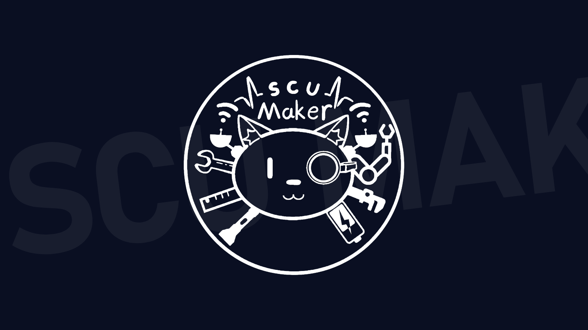
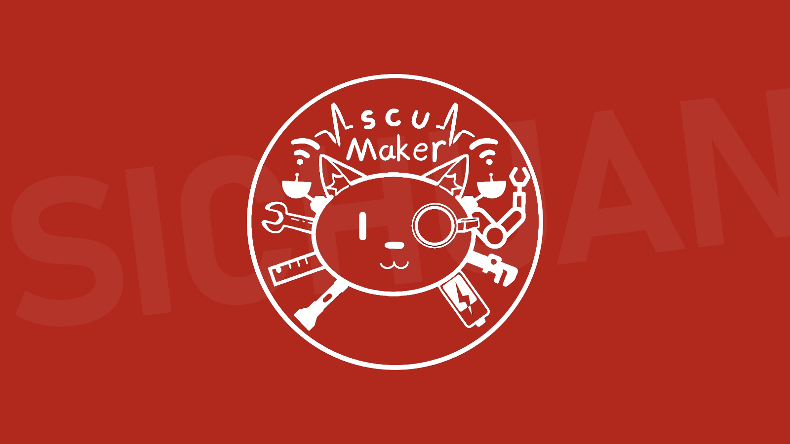
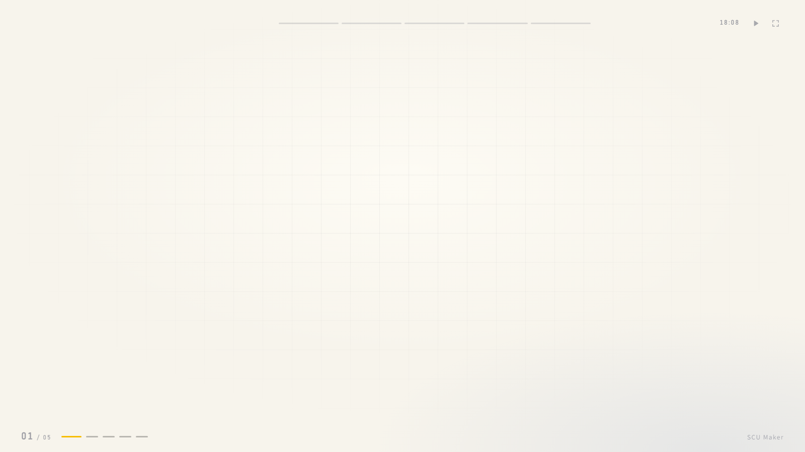
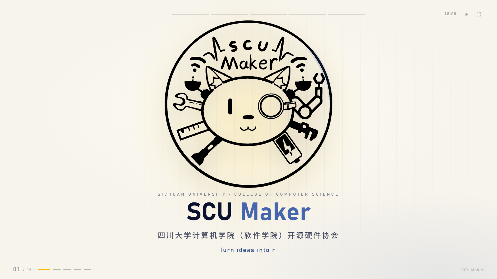
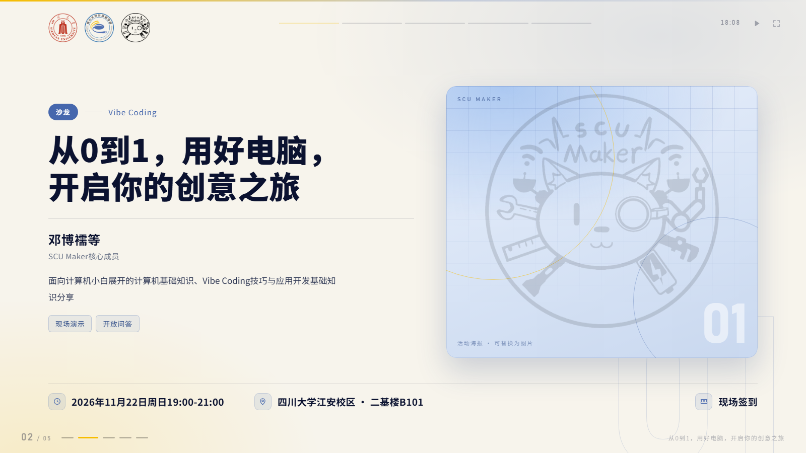
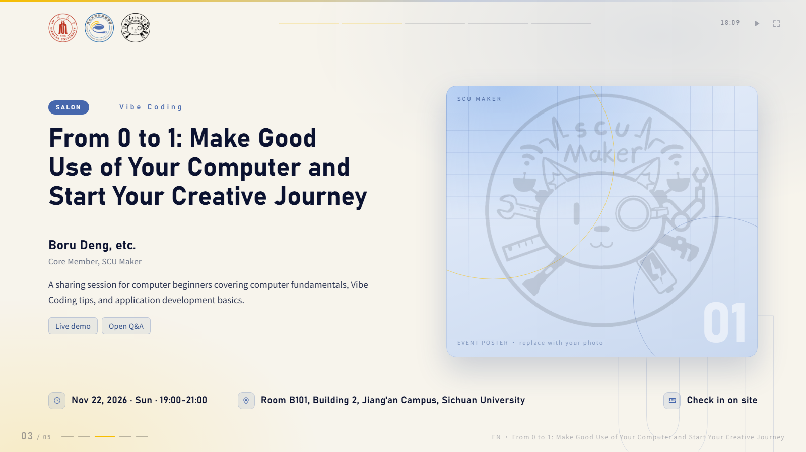

# SCU Maker 协会 · 展示墙动画

一个**纯静态**的网页展示动画：不用装任何东西、不用开服务器，双击 `index.html` 全屏播放即可。

- **第 1 页（开场）**：Logo 色块硬切（米白 / 院徽蓝 / 夜黑 / 院徽金 / 川大红 / 优雅灰）→ 播放 `assets/动画_web.mp4` → **黑场过渡** → Logo 浮现，停留 10 秒
- **第 2 页起（海报）**：每个活动自动生成 **中文页 + 英文页** 两张，横向切换、自动循环；
  正在进行中的活动会带「正在进行中」实时徽标与流光 / 呼吸光晕特效
- 配色取自**四川大学计算机学院院徽**：院徽蓝 `#4667ad`、浅钢蓝 `#7aa8e8`、院徽金 `#f7bd00`，整体浅色纸面
- 左上角只在**海报页**显示协会 Logo（开场页整屏就是 Logo，不再重复）

预览：









---

## 一、怎么用

1. 双击 `index.html`（推荐 **Chrome / Edge**，不推荐 IE）。
2. 按 `F` 进入全屏，展台就绪。
3. 默认自动播放：开场约 17 秒 → 每张海报 9 秒 → 循环。

> 全屏、自动播放都可以在 `js/config.js` 里开关；如果希望一打开就全屏，把
> `fullscreenOnStart` 设为 `true`（浏览器可能要求先点一下页面才允许全屏）。

### 播放控制

| 操作 | 效果 |
| --- | --- |
| `→` / `↓` / `PageDown` / 鼠标滚轮下 / 右侧箭头 | 下一页 |
| `←` / `↑` / `PageUp` / 滚轮上 / 左侧箭头 | 上一页 |
| `空格` / 右上角按钮 | 暂停 / 继续 |
| `F` | 全屏切换 |
| `R` | 重播当前页 |
| `1`–`9` | 直接跳到第 N 页 |
| 底部圆点 | 点击跳页 |
| 手机 / 触摸屏 | 左右滑动 |

鼠标闲置 2 秒后光标自动隐藏，方便展台。

---

## 二、文件结构

```
index.html                  页面骨架（一般不用改）
css/style.css               所有样式与配色
js/config.js                ★ 你只需要改这个
js/intro.js                 第一页：Logo 快切 + 播放 动画.mp4 + Logo 落位
js/poster.js                海报页生成器（中 / 英双语）
js/app.js                   播放控制：横移、循环、进度、快捷键
动画.mp4                    原始动画视频（1280×720，源码保留）
assets/动画_web.mp4         网页主用视频（720p / 30fps / Main@4.0 / 无音轨，约 5.1MB）
assets/动画_web_540.mp4     兜底视频（540p / 30fps / Main@3.1，约 3.0MB）
assets/动画_poster.jpg       视频封面（Firefox 等加载慢时先显示它）
deploy/                     树莓派 4B + Ubuntu 24.04 一键部署（nginx / 开机全屏 / 定时开关机，见 deploy/README.md）
assets/、tools/             （上一版分层猫动画的素材，当前未使用，可删）
敲钉子的猫.png / 哈气的猫.png  原始插画（素材备份）
SCU Maker's Logo.png        协会 Logo（透明底 PNG）
校徽+院徽（高清+抠图版）.png   校徽 + 院徽（左上角排在最前）
preview/                    预览截图
```

---

## 三、替换内容（`js/config.js`）

### 1）全局设置

```js
settings: {
  autoPlay: true,              // 自动播放
  loop: true,                  // 循环
  fullscreenOnStart: false,    // 打开后自动全屏
  showIntroOnce: false,        // true = 只在第一轮播开场，之后循环跳过
  logoImage: "SCU Maker's Logo.png",          // 协会 Logo（排在院徽后面）
  emblemImage: "校徽+院徽（高清+抠图版）.png",   // 左上角排在最前面的校徽 + 院徽
  brandBlue: '#4667ad',
  brandGold: '#f7bd00',
}
```

左上角依次是 **校徽 + 院徽**、**协会 Logo**，两者都可以在 `settings.emblemImage` / `settings.logoImage` 里换图。

**换 Logo**：把透明底、正方形、黑色图形的 PNG 放到 `index.html` 同目录，
把 `logoImage` 改成文件名即可。开场里「白底黑 Logo / 蓝底白 Logo / 黑底白 Logo」
靠 CSS `invert` 自动反色，不用准备两版。

### 2）第一页：Logo 快切 + 开场视频

开场的色块仍然在 `intro.cuts` 里配（每项 `ms` 是停留时长），随后播放视频：

```js
intro: {
  video: 'assets/动画_web.mp4',   // 网页播放的视频；换视频改这里（建议按下方命令压缩）
  poster: 'assets/动画_poster.jpg', // 视频封面图
  duration: 28500,          // 只是初始值，实际时长 = 色块 + 视频时长 + 10s 自动算
  mainTitle: 'SCU Maker',
  subTitle: '四川大学计算机学院（软件学院）开源硬件协会',
  kicker: 'Sichuan University · College of Computer Science',
  cuts: [
    { bg: '#f7f4ec', logo: 'black', ghost: 'SCU MAKER', ms: 520 },
    { bg: '#4667ad', logo: 'white', ghost: 'MAKER',     ms: 500 },
    { bg: '#0a0f22', logo: 'white', ghost: 'SCU MAKER', ms: 500 },
    { bg: '#f7bd00', logo: 'black', ghost: 'MAKER',     ms: 500 },
    { bg: '#b1281c', logo: 'white', ghost: 'SICHUAN',   ms: 460 },  // 川大红
    { bg: '#9a9ea6', logo: 'white', ghost: 'MAKER',     ms: 460 },  // 优雅灰
    { bg: '#f7f4ec', logo: 'black', ghost: 'SCU MAKER', ms: 520 }
  ],
  lines: [ { text: 'Turn ideas into reality.' }, ... ]   // Logo 落位后的打字机文案
}
```

> 视频会静音自动播放（浏览器要求）；想保留原声，把 `js/intro.js` 里 `<video ... muted ...>` 的 `muted` 去掉，并改由用户点击后播放。
### 3）海报页：每个活动写一份中文 + 一份英文

`posters` 是数组，**一个对象自动变成两页**（先中文、后英文），页码、进度条自动增加。

公共字段（两种语言共用）：

| 字段 | 说明 |
| --- | --- |
| `date` | 日期，如 `2026.11.22`（与 `time` 合成一行显示） |
| `weekday` / `weekdayEn` | 中文星期 / 英文星期 |
| `ongoing` | **一般不用写**：是否「正在进行中」按 `date` + `time` 自动判定（见 3.1）。需要临时强制时写 `true` / `false` |
| `color` | 本活动强调色（默认院徽金），进行中活动也会用这个颜色做发光 |
| `duration` | 这一页停留毫秒（中英两页共用） |
| `image` | 海报主图路径；**留空时显示默认模拟图 `模拟图片.png`** |
| `qr` | 报名二维码图片路径，留空不显示 |

`zh` / `en` 里各放这一种语言的全部文字（标签与分类在同一行；底部时间栏自动拼成「2026年11月22日14:00-21:00」）：

> 右侧海报图右下角的大号数字是**活动序号**（第几个活动），中英两页显示同一个数字；底部进度条旁的页码才是当前第几页。

> 长期举办、没有具体日期的活动：把 `date` 留空，时间栏就只显示 `time` 这一行（例如中文 `time: '长期举行'`、英文 `time: 'Ongoing · regular sessions'`）。

```js
{
  date: '2025.11.22', weekday: '周六', weekdayEn: 'Sat',
  // 不用写 ongoing：到 2025-11-22 的 14:00–17:00 会自动变成「正在进行中」
  color: '#f7bd00', duration: 9000, image: '', qr: '',

  zh: {
    tag: '创客工坊',                    // 左上角标签（中文页用中文）
    category: '第 07 期 · 小猫灯制作',   // 与标签同一行
    title: '从 0 到 1：做一个会发光的小猫灯',   // **文字** 可加金色下划线
    speaker: '李思远',
    speakerTitle: 'SCU Maker 技术部部长 / 单片机爱好者',
    time: '14:00 — 17:00',      // 与 date 合成「2026年11月22日14:00-17:00」
    place: '四川大学江安校区 · 计算机学院实验中心 B302',
    description: '……',
    highlights: ['零基础可参加', '工具与材料现场提供', '作品可带走'],
    entry: '免费 · 需提前报名',
    qrText: '扫码报名 · 限 30 人'
  },

  en: {
    tag: 'WORKSHOP',
    category: 'Vol. 07 · Cat Lamp Build',
    title: 'From Zero to One: Build a Glowing Cat Lamp',
    speaker: 'Li Siyuan',
    speakerTitle: 'Head of Tech, SCU Maker · Microcontroller enthusiast',
    time: '14:00 – 17:00',
    place: 'Lab Center B302, College of Computer Science, Jiang'an Campus, SCU',
    description: '……',
    highlights: ['No experience needed', 'Tools & materials provided', 'Take your build home'],
    entry: 'Free · RSVP required',
    qrText: 'Scan to register · 30 seats'
  }
}
```

> 版式规则：中文页只出现中文，英文页只出现英文；底部不显示 TIME / LOCATION / ENTRY
> 这类英文小标签，信息与图标垂直居中对齐，时间显示为「2026年11月22日14:00-21:00」。

路径相对于 `index.html`，建议英文文件名、不要带空格。

### 3.1）正在进行中的活动（**自动判定**）

活动进入时段后会自动“活”起来，**不需要手写 `ongoing: true`**：

| 判定规则 | 结果 |
| --- | --- |
| 活动日期当天，且当前时间在 `time` 时段内（如 `19:00 — 21:00`） | 进行中 |
| 只写了日期、没写 `time` | 当天 0:00–24:00 都算进行中 |
| 只写了开始时间（如 `19:00`） | 到点后持续到当天结束 |
| `date` 留空的长期活动 | 永远不算进行中 |
| 需要临时强制 | 写 `ongoing: true`（强制进行中）/ `false`（强制关闭） |

- 时段支持 `19:00 — 21:00`、`19:00-21:00`、`19:00~21:00` 等写法；跨零点（`22:00-01:00`）也能识别。
- 可选 `postShift: 10`：提前 10 分钟就开始显示「进行中」（热场用）。
- **页面会自己更新**：展台连续开着时，每 30 秒重算一次并切回前台时重算，
  跨过活动的开始 / 结束时刻，徽标与特效会自动出现 / 消失，不用手动刷新。

进行中时这张海报会“活”起来：

| 特效 | 效果 |
| --- | --- |
| 实时徽标 | 左上角标签行最前面加 **「● 正在进行中 / NOW ON」**：雷达图标缓慢脉动、外圈一圈圈外扩 |
| 俯视波浪 | **画面正中央一个波源，3 圈黄色波纹缓慢一圈圈向外扩散**（俯视水面的效果），波带厚实、位置在文字和海报图的下层 |
| 全局呼吸光 | 整页极淡的强调色光晕明暗起伏（只在停留在这页时才开启） |
| 海报框呼吸 | 右侧主视觉外发光 + 四角定位角依次亮起 + 一道光束斜着扫过海报 |
| 时间栏 | 时间图标换成“实时”图标并呼吸，时间文字前加流光写的「进行中 / NOW ON」 |

- 特效颜色取自该活动的 `color`，想更醒目可以换成 `#b1281c`（川大红）或 `#f7bd00`（院徽金）。
- 波纹的速度与厚度在 `css/style.css` 的 `.ripple` 里调：`--dur` 是一圈波荡到出屏的秒数（越大越慢），`--wave-band` 的渐变色标决定波带的宽度与浓淡。
- **只在当前这一页运行**：离开该页（含暂停）后大面积动画自动停止，循环播放也不会额外吃 GPU。
- 低配模式（`lowfx`）与系统「减少动态效果」下会定格成静止的波纹 / 发光，不再滚动。

**想提前看看效果？** 用 `now` 参数模拟时间（只影响页面，不改电脑时间）：

```
index.html?now=2026-11-22T20:00      ← 打开时假装现在是 11 月 22 日 20:00
index.html?slide=3&now=2026-11-22T22:00   ← 22:00 已过，应回到普通海报
```

---

## 四、第一页是怎么播放的

1. **色块硬切**：HTML 层直接切换背景色，黑色 Logo 用 `invert` 反成白色；共 7 刀（含川大红、优雅灰）。
2. **视频**：色块结束时开始播放 `assets/动画_web.mp4`（muted + playsinline 自动播放），铺满画面（`object-fit: cover`）；
   播放前显示 `assets/动画_poster.jpg` 封面，避免黑屏。
3. **结束**：**视频最后 1.5 秒就开始缓慢压黑**（sine 缓入缓出，与画面重叠）→ 视频播完时正好全黑，Logo 已就位 → 黑场**渐退**（1.2s，cubic 缓入缓出）露出纸面 + Logo，随后标题与打字机文案出现。
4. **停留**：Logo 停留 10 秒后自动翻到第一张海报。

时长是自动算的：`色块总时长 + 视频时长 + 黑场退去 1.5 秒 + 10 秒`（压黑与视频尾巴重叠，不额外占时间），进度条也会跟着更新，所以换一个不同长度的视频不用改任何时间配置。

---

## 五、常见问题

**Q：打开是白屏？**
A：确认 `index.html` 和 `css/`、`js/` 在同一目录；用 Chrome / Edge 打开；按 `F12` 看 Console 是否有报错。

**Q：Logo 不显示？**
A：检查 `settings.logoImage` 的文件名与实际文件名完全一致（含空格、单引号）。Logo 应为透明底 PNG。

**Q：海报里的图片不显示？**
A：路径要相对 `index.html`，且文件名不要含中文或空格；注意大小写。

**Q：海报只想要中文 / 只想要英文？**
A：删掉 `js/app.js` 里 `['zh','en']` 中的一项即可（例如改成 `['zh']`），或把 `en` 里的内容改成中文。

**Q：想改配色？**
A：`css/style.css` 顶部 `:root` 里的 `--blue`、`--blue-2`、`--gold`、`--paper` 就是全部主题色；
`js/config.js` 的 `brandBlue` / `brandGold` 会覆盖前两个。

**Q：投影仪是 4:3 或异形比例？**
A：页面按屏幕自适应；第一页画板会等比缩放居中，海报页会切换为单列布局。

**Q：循环时不想每次都播开场？**
A：把 `showIntroOnce` 设为 `true`。

---

## 六、Firefox 卡顿 / 闪退的修复（已内置）

原先用 18MB、10 Mbps 的原始视频，Firefox（尤其是树莓派这类 ARM 板）会疯狂占用内存直至闪退。
现在做了四层处理：

1. **换成网页专用视频** `assets/动画_web.mp4`：H.264 **Main** profile、1280×720、**无音轨**、**每 0.5 秒一个关键帧**、`+faststart`，体积 18MB → **4.3MB**。
   重新生成命令（需要 ffmpeg）：

   ```bash
   ffmpeg -i 动画.mp4 -an -vf "fps=30,scale=1280:720" -c:v libx264 -profile:v main -level 4.0 -pix_fmt yuv420p \
          -crf 23 -x264-params "keyint=30:min-keyint=30:scenecut=0" \
          -movflags +faststart -preset slow -tune animation assets/动画_web.mp4
   ffmpeg -i assets/动画_web.mp4 -frames:v 1 -vf scale=640:-1 assets/动画_poster.jpg -q:v 4
   ```

2. **视频加载策略**：`preload="none"` + `poster` 封面，播完立刻 `pause`，离开第一页时**彻底释放视频源**（Firefox 不释放解码器是内存暴涨的主因）。
3. **播放兜底**：元数据 3.5 秒内没到、或视频 1.2 秒还不前进 → 自动放弃视频，页面照常显示 Logo，不会卡死。
4. **低配模式** `body.lowfx`：自动检测 Firefox / 低核数 / 高 DPI / 软件渲染，关闭像素噪点、旋转光环、扩散环、发光阴影等耗 GPU 的效果。

手动控制低配模式：

```
http://<IP>/?lowfx=1     强制开启低配（推荐给 Firefox / 树莓派）
http://<IP>/?lowfx=0     强制关闭
```

如需全局默认开启，在 `js/config.js` 的 `settings` 里加一行 `lowfx: true`。

> 展台机箱建议：**树莓派上优先用 Chromium kiosk**（见 deploy/README.md 第五节），
> 性能与视频兼容性都比 Firefox 稳；如果必须用 Firefox，请配合 `?lowfx=1` 与更新的 Firefox ESR。

---

## 七、视频如何「始终留在内存」

板子上内存/CPU 都不高，但视频加载失败，通常是**视频格式超出了板子的硬解能力**，而不是内存不够。现在做了三件事：

### 7.1 视频一次下载、全程复用

- `<video preload="auto" autoplay>` + 进入页面时 `primeVideo()` 预播 0.6 秒，
  让浏览器立刻把**整段视频**（约 5MB）缓存进内存（实测 `buffered` 范围 = `0–15s` 全覆盖）。
- 离开开场页只 `pause()`，**不销毁视频源**，所以循环到第二圈不会再发起网络请求（实测 mp4 只请求 1 次）。
- `assets/` 里保留两个版本：

| 文件 | 参数 | 大小 | 用途 |
| --- | --- | --- | --- |
| `assets/动画_web.mp4` | 1280×720 / **30fps** / H.264 **Main@4.0** / 无音轨 | 5.1 MB | 主用（树莓派 V4L2 硬解可解） |
| `assets/动画_web_540.mp4` | 960×540 / 30fps / Main@3.1 | 3.0 MB | 兜底（主视频解不出来时自动回退） |

> 之前失败的关键是 **60fps** 码流：树莓派 4B 的 V4L2 硬解对帧率很敏感，
> 换成 30fps、每 0.5 秒一个关键帧、无音轨后基本都能硬解；仍不行就回退到 540p 版。

### 7.2 浏览器自动回退

`js/config.js`：

```js
video: 'assets/动画_web.mp4',          // 主用
videoFallback: 'assets/动画_web_540.mp4', // 主用解不出来时自动换这个
```

浏览器拿到第一个 `<source>` 解不出来时会自动尝试第二个（DOM 里已经能看到两个 `<source>`）。

### 7.3 重新压缩视频的命令

换新视频时按这两档压：

```bash
# 720p30（主用）
ffmpeg -i 动画.mp4 -an -vf "fps=30,scale=1280:720" -c:v libx264 -profile:v main -level 4.0 \
  -pix_fmt yuv420p -crf 23 -x264-params "keyint=30:min-keyint=30:scenecut=0" \
  -movflags +faststart -preset slow -tune animation assets/动画_web.mp4

# 540p30（兜底）
ffmpeg -i 动画.mp4 -an -vf "fps=30,scale=960:540" -c:v libx264 -profile:v main -level 3.1 \
  -pix_fmt yuv420p -crf 23 -x264-params "keyint=30:min-keyint=30:scenecut=0" \
  -movflags +faststart -preset slow -tune animation assets/动画_web_540.mp4

# 封面（取第一帧）
ffmpeg -i assets/动画_web.mp4 -frames:v 1 -vf "scale=640:-1" assets/动画_poster.jpg -q:v 4
```

### 7.4 如果树莓派仍然放不出来

在板子上照着 README 第十节排查：

```bash
# 1) 用系统播放器验证能否硬解（能播 = 浏览器参数问题；不能播 = 码流问题）
sudo apt install -y ffmpeg
ffmpeg -v error -i /srv/maker/current/assets/动画_web.mp4 -f null -    # 应无报错

# 2) 走软解兜底（放弃硬解，吃 CPU 但能出画面）
#    编辑 /opt/maker/maker-kiosk-run.sh，去掉 --use-gl=egl，或改用 firefox
#    --disable-accelerated-video-decode --use-gl=egl

# 3) 检查 /dev/video* 与 VAAPI 支持
ls /dev/video*
vainfo 2>/dev/null || echo "没有 vainfo（可 apt install vainfo）"
```